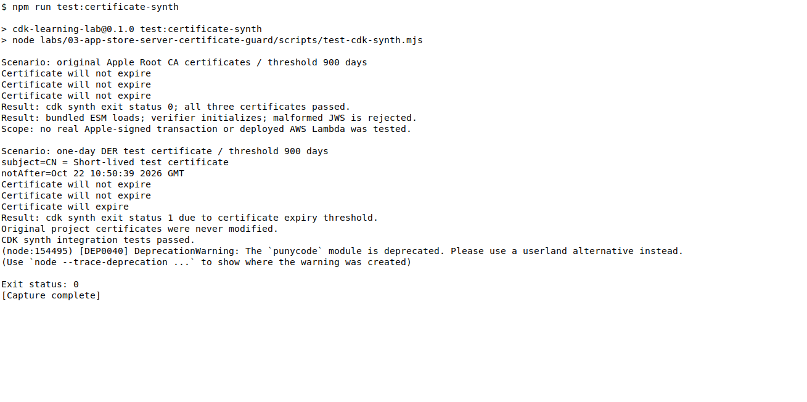

# Lambda に同梱する証明書の期限を CDK のビルド時にチェックする

App Store Server API のレスポンスに含まれる、Apple が署名した JWS を Lambda で検証する例です。Lambda に同梱する Apple Root CA 証明書を、CDK の `NodejsFunction` がバンドルする前に OpenSSL で検査します。設定した期間以内に有効期限を迎える証明書があれば、`cdk synth` は失敗します。

これは将来のメンテナンス時に証明書を見直すきっかけを作る簡易チェックです。証明書の自動更新、取消し確認、実行中 Lambda の継続監視は扱いません。

> `.p8` 秘密鍵はこのリポジトリに含めていません。App Store Server API を呼び出すための秘密鍵は、Secrets Manager などで保護してください。

## 構成

```text
Lambda の実行用ファイル
├── index.mjs
└── certificates/
    ├── apple-inc-root.cer
    ├── apple-root-ca-g2.cer
    └── apple-root-ca-g3.cer
```

`beforeBundling` は各証明書に対して次のコマンドを実行します。サンプルの閾値は900日です。プロジェクトの保守間隔と、調査・更新に必要な余裕に合わせて `minimumCertificateValidityDays` を調整してください。

```bash
openssl x509 -inform DER -in certificate.cer -checkend 77760000 -noout
```

検査した証明書は `afterBundling` で Lambda アセットへコピーします。同じ証明書名のリストを使うことで、検査対象と実行時に読み込む証明書がずれないようにしています。

## 前提条件

- Node.js 24 以降
- Bash
- OpenSSL

AWS アカウントやデプロイ権限は、以下のローカル検証には必要ありません。

## 実行

```bash
npm ci
npm run synth
```

通常の Apple Root CA 証明書では、3回の `Certificate will not expire` が出力され、`cdk synth` が成功します。

次のテストは一時コピー内で実行します。元の証明書を変更せず、1日間だけ有効な DER 形式のテスト証明書へ差し替え、期限不足で `cdk synth` が終了ステータス1になることを検証します。

```bash
npm run test:certificate-synth
```



## 範囲

- Sandbox 用の `SignedDataVerifier` を初期設定にしています。本番では実際の Bundle ID、`APP_STORE_ENVIRONMENT=Production`、数値の `APP_APPLE_ID` を設定してください。
- 実際の AWS 環境へのデプロイや、Apple が署名した実データの検証は行いません。
- Apple Root CA 証明書の入手方法は、[Apple の App Store Server Library の案内](https://github.com/apple/app-store-server-library-node#obtaining-apple-root-certificates)を参照してください。

## ライセンス

[MIT](LICENSE)
